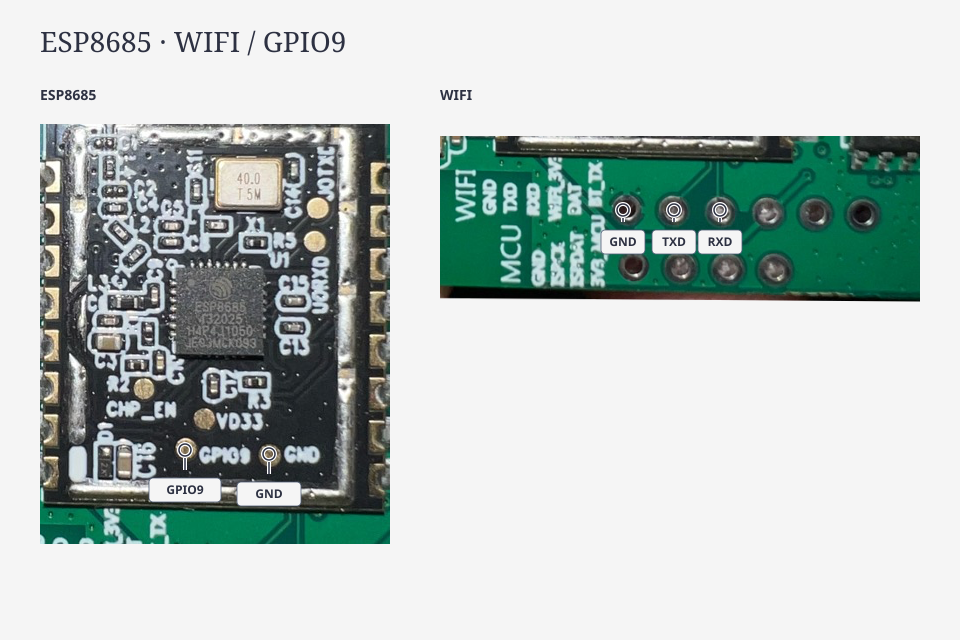
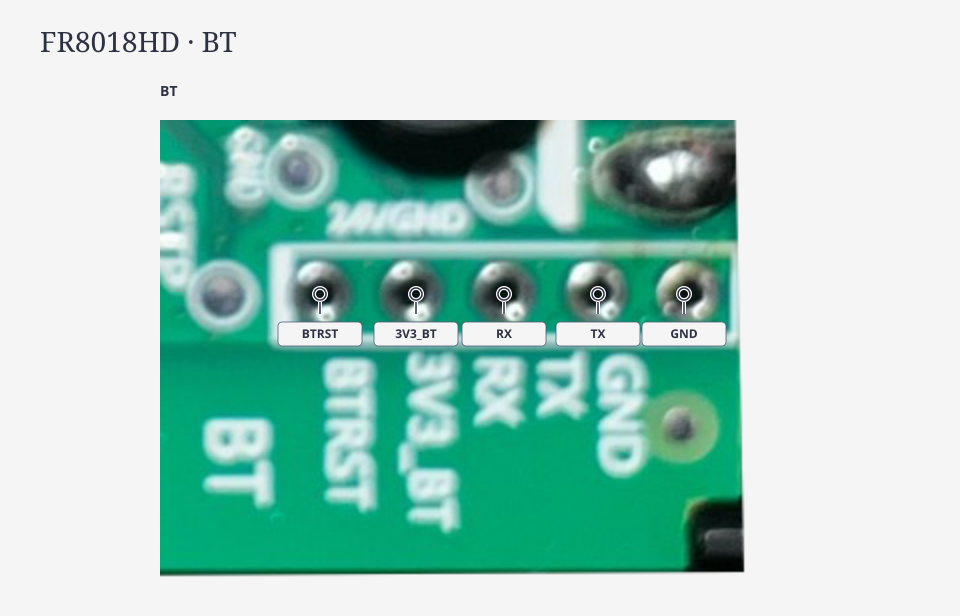

[Deutsch](#deutsch) | [English](#english)

# Deutsch

## Platine und Anschlüsse

Die Platine befindet sich im Bedienteil im Kabel der Lampe. Zum Öffnen die vier Schrauben an der Rückseite lösen.

ESPHome wird auf den **ESP8685** geflasht. Der **FR8018HD** behält seine Originalfirmware. Er steuert die LEDs, verarbeitet Tastendrücke und Mikrofonsignale und führt Szenen, Musikmodi sowie den Schlafmodus aus.

Zudem enthält die Originalfirmware Zeitplan- und Aufweckfunktionen sowie DreamView-Code zur Synchronisierung mehrerer Lampen. Über die ESPHome-Komponente lassen sich diese Funktionen derzeit nicht steuern; ein funktionsfähiger DreamView-Steuerungsweg für diese H6076 ist bislang nicht bestätigt.

Neben dem ESP liegen die Pins mit den Beschriftungen `WIFI` und `MCU`. Zum Flashen die Pins bei **WIFI** verwenden.

## Anschließen

Das Netzteil der Lampe abziehen. Einen USB-UART-Adapter mit **3,3-V-Signalpegeln** an die Pins bei `WIFI` anschließen:

- Adapter `GND` mit `GND` verbinden.
- Adapter `RX` mit `TXD` verbinden.
- Adapter `TX` mit `RXD` verbinden.
- Am ESP `GPIO9` mit `GND` verbinden.

Die Lampe wird über ihr Originalnetzteil versorgt; Adapter-VCC bleibt frei.

## Flashen

1. Die [Geräte-YAML einrichten](../examples/H6076.md#deutsch).
2. Den USB-UART-Adapter am Rechner anschließen. Bei angeschlossener GPIO9-GND-Brücke das Netzteil der Lampe wieder anschließen; der ESP8685 startet im Downloadmodus.
3. Die Firmware nach der [offiziellen ESPHome-Anleitung](https://esphome.io/guides/faq/#how-do-i-install-esphome-onto-my-device) übertragen. Bei manuellem Download für die Erstinstallation das **Factory-Format** (`firmware.factory.bin`) nutzen.
4. Nach erfolgreicher Übertragung das Netzteil abziehen, Brücke und Adapterleitungen entfernen, das Bedienteil schließen und das Netzteil wieder anschließen.
5. Die Lampe über die [ESPHome-Integration in Home Assistant](https://www.home-assistant.io/integrations/esphome/) einbinden. Ein/Aus, Dimmen, RGB, Warmweiß und den Taster prüfen.

Weitere Firmwareupdates erfolgen [über WLAN mit ESPHome OTA](https://esphome.io/components/ota/esphome/).

Wird der ESP8685 nicht erkannt, die Verbindungen bei `WIFI` und die beim Einschalten eingesetzte GPIO9-GND-Brücke prüfen.

## BT

Während der ESPHome-Installation bleibt BT unverbunden.

[Projekt](../README.md#deutsch) · [Konfiguration](../examples/H6076.md#deutsch)

---

# English

## Board and connections

The board is located in the lamp's inline control unit. To open it, remove the four screws on the back.

Flash ESPHome onto the **ESP8685**. The **FR8018HD** retains its original firmware. It controls the LEDs, processes button presses and microphone signals, and runs scenes, music modes and sleep mode.

The original firmware also includes scheduling and wake-up functions as well as DreamView code for synchronizing multiple lamps. These functions are not yet controllable via the ESPHome component; a functional DreamView control path for this H6076 has not yet been confirmed.

The pins labeled `WIFI` and `MCU` are next to the ESP. Use **WIFI** for flashing.

## Connect the adapter

Disconnect the lamp's power supply. Attach a USB-UART adapter with **3.3 V signal levels** to the pins at `WIFI`:

- Connect adapter `GND` to `GND`.
- Connect adapter `RX` to `TXD`.
- Connect adapter `TX` to `RXD`.
- Connect `GPIO9` to `GND` on the ESP.

The lamp uses its original power supply; keep the adapter VCC disconnected.

## Flash the firmware

1. [Set up the device YAML](../examples/H6076.md#english).
2. Plug the USB-UART adapter into the computer. With GPIO9 connected to GND, reconnect the lamp's power supply to start the ESP8685 in download mode.
3. Upload the firmware following the [official ESPHome instructions](https://esphome.io/guides/faq/#how-do-i-install-esphome-onto-my-device). For a manual download, select **Factory format** (`firmware.factory.bin`) for the first installation.
4. Once the upload succeeds, unplug the lamp's power supply, remove the bridge and adapter wires, close the control unit and reconnect the power supply.
5. Add the lamp through the [ESPHome integration in Home Assistant](https://www.home-assistant.io/integrations/esphome/). Check power, dimming, RGB, warm white and the button.

Subsequent firmware updates use [ESPHome OTA over Wi-Fi](https://esphome.io/components/ota/esphome/).

If the ESP8685 is not detected, check the WIFI connections and that GPIO9 was connected to GND at power-on.

## BT

Keep BT disconnected while installing ESPHome.

[Project](../README.md#english) · [Configuration](../examples/H6076.md#english)
